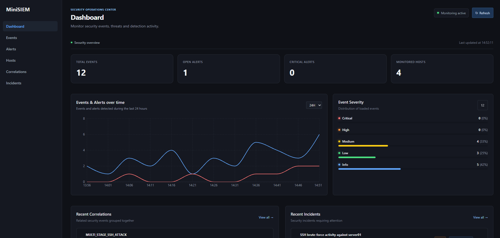
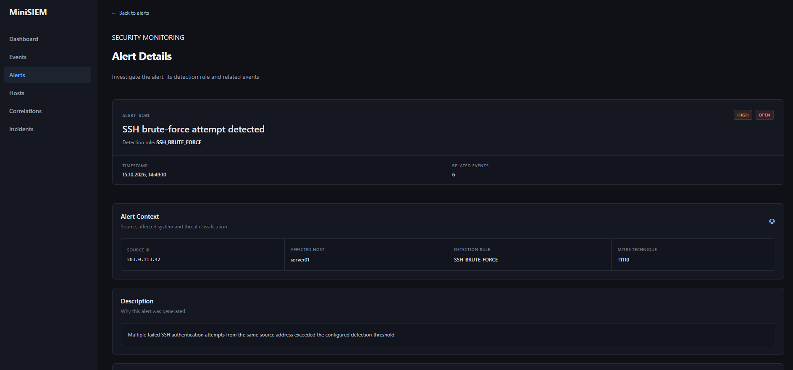

# MiniSIEM — Security Information and Event Monitoring

A lightweight, full-stack Security Information and Event Management (SIEM) learning project built with Python, FastAPI, React, and PostgreSQL.

MiniSIEM collects and processes security-relevant log events, detects suspicious SSH activity, generates alerts, and correlates related alerts into potential attack patterns. A web-based dashboard provides an overview of events, alerts, correlations, incidents, and monitored hosts.

**This project was developed for educational purposes** to explore SIEM architecture, security event processing, detection engineering, backend development, and full-stack application design.

**[Live Demo](DEMO_URL_HERE)** · **[Source Code]((https://github.com/BigTimeError/MiniSiem/tree/main/backend))**



---

## Overview

Security logs contain valuable information about activity on a system, but identifying suspicious behavior manually can be difficult. SIEM systems address this challenge by collecting, processing, and analyzing events from different sources.

MiniSIEM implements a simplified version of this workflow. It focuses on SSH authentication activity and demonstrates how raw log entries can be transformed into structured events, security alerts, and correlated findings.

### Key Features

- **Log collection:** Continuously monitors SSH authentication logs.
- **Event parsing:** Converts raw log entries into structured security events.
- **Rule-based detection:** Identifies suspicious SSH activity, including root logins, brute-force attempts, and user enumeration.
- **Alert generation:** Creates alerts when detection rules are triggered.
- **MITRE ATT&CK mapping:** Associates security alerts with relevant MITRE ATT&CK techniques to provide additional context for detected suspicious activity.
- **Alert correlation:** Connects related alerts to identify potential attack sequences.
- **Web dashboard:** Displays security statistics, event trends, recent alerts, correlations, and incidents.
- **Event and host exploration:** Allows users to inspect individual events and view information aggregated by host.
- **REST API:** Exposes backend functionality to the frontend.
- **Real-time updates:** Uses Server-Sent Events (SSE) to stream updates to connected clients.
- **Containerized deployment:** Uses Docker to simplify running the application and its database.

## Dashboard

The web interface provides a centralized overview of the security activity processed by MiniSIEM.

The dashboard and detail pages are designed to make security findings easier to explore, from high-level statistics down to individual events and related alerts.

> **Demo:** Visit the live demo to explore the interface and see the implemented features in action. The demo is intended for demonstration purposes and may use sample data or have limited functionality compared with a locally running instance.

**[Open the MiniSIEM Demo](DEMO_URL_HERE)**

## Architecture

MiniSIEM separates log collection, event processing, detection, persistence, and presentation into distinct components.

### Event Processing Pipeline

```text
SSH Authentication Logs
          |
          v
     SSHCollector
          |
          v
       SSHParser
          |
          v
    EventRepository
          |
          v
     DetectionEngine
          |
          v
     AlertRepository
          |
          v
   CorrelationEngine
          |
          v
  CorrelationRepository
          |
          v
       PostgreSQL
          |
          v
      FastAPI
          |
          v
    React Frontend
```

The pipeline represents the main processing flow. The frontend retrieves information through the API, while SSE provides a mechanism for delivering real-time updates.

### Main Components

| Component | Responsibility |
|---|---|
| `Agents` | Designed to simulate a server that uses SSHCollector. |
| `SSHCollector` | Reads SSH authentication log entries. |
| `SSHParser` | Extracts relevant information and converts log entries into structured events. |
| `EventRepository` | Persists and retrieves security events. |
| `DetectionEngine` | Evaluates events against configured detection rules. |
| `AlertRepository` | Stores and retrieves generated alerts. |
| `CorrelationEngine` | Identifies relationships between alerts that may indicate a broader attack pattern. |
| `CorrelationRepository` | Persists and retrieves correlation results. |
| `FastAPI` backend | Exposes application data and functionality through API endpoints. |
| `React` frontend | Presents events, alerts, correlations, incidents, hosts, and dashboard statistics. |
| `PostgreSQL` | Stores application data persistently. |

## Detection Capabilities

MiniSIEM currently focuses on selected SSH-related security scenarios.

### Implemented Detection Rules

| Rule | Description |
|---|---|
| `SSH_ROOT_LOGIN` | Detects SSH authentication activity involving root logins. |
| `SSH_BRUTE_FORCE` | Detects repeated failed SSH authentication attempts that match the configured detection criteria. |
| `SSH_USER_ENUMERATION` | Detects patterns of invalid-user login attempts that may indicate attempts to discover valid usernames. |

The detection engine applies rule-specific conditions to incoming events. When a rule is triggered, an alert is generated and stored for further investigation.



### MITRE ATT&CK Mapping

MiniSIEM enriches security alerts with relevant techniques from the **[MITRE ATT&CK](https://attack.mitre.org/)** framework. This mapping provides additional context for detected activity by connecting rule-based findings to documented adversary tactics and techniques.

By associating alerts with MITRE ATT&CK techniques, MiniSIEM helps users better understand the potential security implications of detected behavior and provides a foundation for investigating alerts from an attacker-technique perspective.

The mapping complements the detection rules and alert correlation mechanisms by adding a standardized security classification to individual findings.

### Alert Correlation

Individual alerts provide valuable information, but correlating related alerts can reveal broader attack patterns across events and hosts.

MiniSIEM implements the following correlation rules:

- **`ssh_attack_chain_correlation`** — Correlates related SSH security alerts to identify potential attack sequences.
- **`ssh_compromise_chain`** — Identifies combinations of related security findings that may indicate a potential SSH compromise.
- **`ssh_multi_host_atack`** — Detects related SSH activity across multiple hosts that may indicate a coordinated attack.

These rules demonstrate how individual security alerts can be connected to identify potentially meaningful relationships and attack patterns.

**Note:** Correlation results are rule-based indicators, not proof that a system has been compromised. The implemented rules cover a limited set of scenarios and are not intended to replace a comprehensive production detection system.

### Incident Management

MiniSIEM includes an `IncidentEngine` that turns security correlations into manageable security incidents. While alert correlation identifies relationships between alerts, incident management groups related security findings into incidents that can be investigated and tracked over time.

The `IncidentEngine` provides the following functionality:

- **Automatic incident creation:** Creates an incident when a correlation indicates a potential security incident.
- **Alert and correlation association:** Links related alerts and the triggering correlation to the incident.
- **Incident deduplication and aggregation:** Adds new related alerts and correlations to an existing open incident when the source IP and affected host match.
- **Severity calculation:** Determines the incident severity based on the highest severity among its related alerts.
- **Contextual incident descriptions:** Generates a title and description based on the detected correlation type.
- **Incident status tracking:** Initializes new incidents with an `OPEN` status, allowing them to be managed as part of an incident investigation workflow.

The engine distinguishes between different types of potential security incidents, including:

- **SSH Attack Chain** — A potential SSH attack sequence.
- **SSH Server Compromise** — Activity that may indicate a compromised SSH server.
- **SSH Multi-Host Attack** — Related SSH activity involving multiple hosts.

This component demonstrates how correlated security alerts can be consolidated into incidents, reducing fragmentation and providing a more structured starting point for security investigations.

**Note:** Incidents represent potential security issues identified by predefined correlation rules. They do not independently confirm that a compromise has occurred.

## Technology Stack

### Backend

- **Python** — Application logic, event processing, and detection rules.
- **FastAPI** — REST API and backend service.
- **Uvicorn** — ASGI server.
- **SQLAlchemy** — Database models and persistence.
- **Alembic** — Database schema migrations.
- **Pydantic** — Data validation and API schemas.
- **Server-Sent Events (SSE)** — Real-time event streaming to connected clients.

### Frontend

- **React** — Component-based user interface.
- **TypeScript** — Static typing for frontend code.
- **Vite** — Frontend development server and production build tooling.
- **CSS** — Dashboard styling and layout.

### Database and Infrastructure

- **PostgreSQL** — Persistent storage for events and security findings.
- **Docker** — Containerization of application services.
- **Docker Compose** — Local orchestration of the frontend, backend, and database.

## Project Structure

The project is organized into separate frontend and backend components. The backend separates event ingestion, detection, persistence, and API functionality.

```text
SIEM/
├── backend/
│   ├── collectors/       # Log collection
│   ├── parsers/          # Log parsing
│   ├── detection/        # Detection and correlation logic
│   ├── storage/          # Database access and repositories
│   ├── api/              # API routes and endpoints
│   ├── tests/            # Backend tests
│   ├── alembic/          # Database migrations
│   └── ...
├── frontend/
│   ├── src/
│   │   ├── components/   # Reusable UI components
│   │   ├── pages/        # Dashboard and detail pages
│   │   └── ...
│   └── ...
├── docker-compose.yml
└── README.md
```

## Getting Started

### Prerequisites

To run MiniSIEM locally, you will need:

- Docker
- Docker Compose
- Git

A Linux environment with SSH authentication logs is required if you want to collect real SSH events from the host.

### Installation

Clone the repository:

```bash
git clone REPOSITORY_URL_HERE
cd SIEM
```

Build and start the application:

```bash
docker compose up --build -d
```

Check the running services:

```bash
docker compose ps
```

View the service logs:

```bash
docker compose logs -f
```

The backend is configured to expose its API on port `8000`. If the frontend service is configured to expose port `3000`, open:

- Frontend: `http://localhost:3000`
- API documentation: `http://localhost:8000/docs`

The actual frontend address depends on the port mapping in the Docker Compose configuration.

### SSH Log Collection

The collector is designed to read SSH authentication logs, such as `/var/log/auth.log` on Debian-based Linux systems.

Access to the host log file must be configured appropriately in Docker Compose. The collector uses a read-only log mount in the container configuration.

Log paths and availability vary by Linux distribution. For example, some systems use `/var/log/secure` instead of `/var/log/auth.log`.

**Security note:** Only collect logs from systems you own or are explicitly authorized to monitor. Review file permissions and container configuration before enabling access to host logs.

## Testing

MiniSIEM includes tests for selected backend components and security event processing.

The testing setup uses PostgreSQL for database integration tests, with a separate test database to isolate test data from the application database.
Sometimes, after reconfiguring docker, the test database is not importet and started. You might have to recreate it.

Tests can be run using the project's configured Python environment and test dependencies. For example, if `pytest` is configured:

```bash
pytest
```

The exact test command and required environment variables should follow the project's test configuration.

## Limitations and Scope

MiniSIEM is a learning project, not a production-ready SIEM platform.

The current implementation has a deliberately limited scope:

- Detection is based on a small set of predefined SSH-related rules.
- The agents have not yet any functionality to function from different systems and communicate with th main system.
- The available log sources and supported event types are limited.
- Rule-based detections can produce false positives and may miss attacks that do not match the configured criteria.
- Alert correlation covers selected relationships rather than general attack-chain analysis.
- Production features such as role-based access control, hardened multi-tenant deployment, comprehensive monitoring, and extensive detection coverage are outside the current scope.

The live demo is intended to showcase the user interface and implemented functionality. It should not be used to monitor real infrastructure or submit sensitive log data.

## Learning Objectives

This project was developed to gain practical experience with:

- SIEM architecture and security event pipelines.
- Linux SSH authentication logs and log parsing.
- Rule-based detection engineering.
- Alert generation and event correlation.
- REST API design with FastAPI.
- Relational database modeling and persistence with PostgreSQL and SQLAlchemy.
- Database migrations with Alembic.
- Real-time communication using Server-Sent Events.
- Frontend development with React and TypeScript.
- Containerization and service orchestration with Docker Compose.
- Backend testing and database integration testing.

## Future Improvements

Potential extensions include:

- Additional log sources and detection rules.
- More configurable thresholds and detection windows.
- Improved correlation across multiple event types.
- Authentication and role-based access control.
- More extensive automated testing.
- Improved alert investigation workflows.
- Deployment hardening and operational monitoring.

## Disclaimer

MiniSIEM is provided for educational and demonstration purposes only. It is not a substitute for a professionally maintained SIEM solution, a security monitoring service, or a comprehensive incident response process.

Use it only in environments you are authorized to monitor.

## License

No license has been specified yet. Unless a license is added to the repository, the project should not be assumed to be open source or freely reusable.
